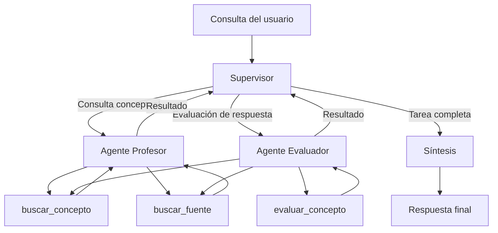
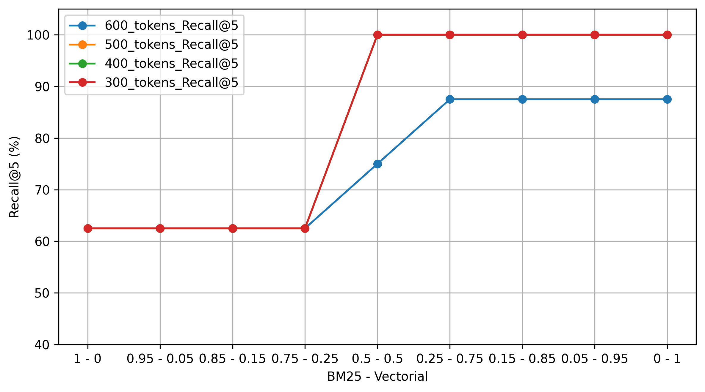
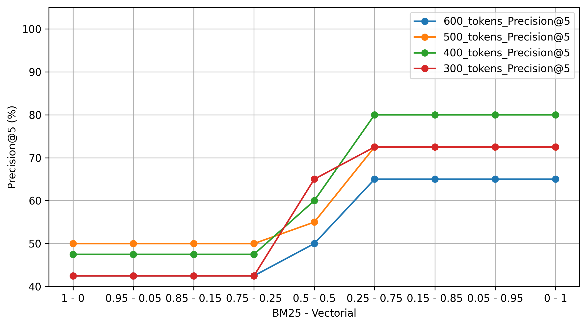

# Sistema multiagente de tutoría en Estadística y Metodología

Sistema inteligente de tutoría académica basado en agentes especializados, recuperación híbrida de información (RAG), evaluación de respuestas y supervisión humana. La aplicación integra una API asíncrona, procesamiento en segundo plano, persistencia del estado y observabilidad de las ejecuciones.

## Descripción general

El sistema permite que un usuario solicite explicaciones de conceptos de Estadística y Metodología de la Investigación, consulte fuentes bibliográficas o reciba una evaluación de sus respuestas.

La arquitectura utiliza un grafo de agentes coordinado por un supervisor. Los agentes especializados consultan una base de conocimientos mediante un recuperador híbrido que combina búsqueda léxica y similitud semántica. Cuando corresponde, el flujo incorpora una instancia de revisión humana antes de continuar con la evaluación y la síntesis de la respuesta final.

La aplicación expone sus funcionalidades mediante una API REST desarrollada con FastAPI. Las tareas se procesan de manera asíncrona mediante una cola de Redis y un Worker independiente. LangGraph administra el flujo de ejecución y permite persistir el estado necesario para interrumpir y reanudar las tareas.

El proyecto incorpora observabilidad mediante Arize Phoenix, instrumentación con OpenInference, registro de trazas en JSON y tests automatizados.

## Arquitectura del sistema

```text
                         Cliente
                            |
                            v
                     FastAPI / REST
                            |
                 +----------+----------+
                 |                     |
                 v                     v
           Estado en Redis       Cola de tareas
                                       |
                                       v
                                     Worker
                                       |
                                       v
                                    LangGraph
                                       |
                                   Supervisor
                                       |
                      +----------------+----------------+
                      |                                 |
                      v                                 v
                Agente profesor                 Agente evaluador
                      |                                 |
                      +----------------+----------------+
                                       |
                              Recuperador híbrido
                                       |
                              Base de conocimientos
                                       |
                                       v
                              Revisión humana (HITL)
                                       |
                                       v
                                    Síntesis
                                       |
                                       v
                                  Resultado final
```

El diagrama representa los componentes principales y sus relaciones funcionales. El orden efectivo de ejecución depende de las decisiones del supervisor y de las condiciones definidas en el grafo.

---

## Arquitectura multiagente

El sistema utiliza una topología jerárquica en la que un Supervisor coordina dos agentes especializados: un Profesor, orientado a consultas conceptuales, y un Evaluador, encargado de analizar las respuestas de los estudiantes.



### Componentes principales

- **FastAPI:** recibe las solicitudes y expone los endpoints de procesamiento, consulta de estado y aprobación humana.
- **Redis:** almacena el estado de las tareas y administra las colas de procesamiento y aprobación.
- **Worker asíncrono:** consume las tareas pendientes y ejecuta el grafo fuera del contexto de la solicitud HTTP.
- **LangGraph:** coordina los agentes, administra las transiciones del flujo y permite interrumpir y reanudar la ejecución.
- **Supervisor:** decide qué agente debe intervenir y cuándo corresponde finalizar el proceso.
- **Agente profesor:** recupera información teórica y fuentes relevantes para responder consultas académicas.
- **Agente evaluador:** evalúa las respuestas del usuario mediante una herramienta de similitud semántica y consulta información de respaldo.
- **Nodo de síntesis:** integra las contribuciones del sistema en una respuesta final.
- **Arize Phoenix:** permite inspeccionar las trazas y analizar las ejecuciones instrumentadas.
- **Trazas JSON:** conservan un registro adicional de los mensajes, las llamadas a herramientas y las intervenciones humanas.

## Recuperación híbrida de información (RAG)

El sistema utiliza un recuperador híbrido que combina dos mecanismos complementarios:

- **Búsqueda léxica BM25:** recupera documentos a partir de coincidencias entre términos.
- **Búsqueda vectorial:** utiliza embeddings para recuperar documentos semánticamente similares a la consulta.

Los resultados de ambos mecanismos se combinan mediante una estrategia de ponderación para producir una lista de documentos relevantes.

La recuperación híbrida se utiliza para buscar definiciones, explicaciones teóricas y fuentes bibliográficas. Los documentos recuperados constituyen el material de referencia de los agentes especializados.

### Herramientas de recuperación y evaluación

| Herramienta | Función |
|---|---|
| `buscar_concepto` | Recupera contenido teórico relevante para explicar un concepto. |
| `buscar_fuente` | Recupera información bibliográfica y números de página. |
| `evaluar_concepto` | Compara semánticamente la respuesta del usuario con el contenido recuperado. |

La herramienta de evaluación utiliza umbrales heurísticos para asignar una de cuatro categorías: `Mal`, `Incompleta`, `Bien` y `Muy bien`.

Estos umbrales no están calibrados empíricamente. La similitud semántica constituye una señal de comparación con los documentos recuperados, pero no es por sí sola una medida definitiva de la calidad conceptual de una respuesta.

### Configuración del recuperador

El recuperador utiliza `EnsembleRetriever` para combinar los resultados de BM25 y de la búsqueda vectorial. La configuración seleccionada a partir de las pruebas históricas es:

| Parámetro | Valor |
|---|---:|
| Modelo de embeddings | `sentence-transformers/all-MiniLM-L6-v2` |
| Almacenamiento vectorial | Pinecone |
| Métrica de similitud vectorial | Coseno |
| Tamaño de chunk | 400 tokens |
| Solapamiento entre chunks | 100 tokens |
| `top-k` | 5 |
| Peso de BM25 | 0.25 |
| Peso de búsqueda vectorial | 0.75 |

Esta configuración busca equilibrar la coincidencia léxica con la recuperación semántica. Los parámetros fueron seleccionados mediante una evaluación histórica sobre un Golden Set específico, cuyos resultados se presentan a continuación.

### Evaluación histórica del recuperador

Durante la Pre-Entrega 4 se realizaron experimentos para analizar el efecto del tamaño de los chunks y de la ponderación de los recuperadores BM25 y vectorial.

La evaluación utilizó un Golden Set y las métricas **Precision@5** y **Recall@5**. Se compararon distintos tamaños de chunk manteniendo un solapamiento de 100 tokens.

**Importante:** estos resultados corresponden a la evaluación histórica del recuperador en una versión anterior del proyecto. Aunque la estrategia de recuperación se conserva, la arquitectura y las interfaces de los agentes cambiaron durante el desarrollo del sistema multiagente final. Por lo tanto, los resultados no constituyen una evaluación integral del sistema final ni pueden considerarse directamente reproducibles mediante el código actual sin adaptar y validar el procedimiento de evaluación.

#### Recall@5

La Figura 1 muestra el Recall@5 obtenido para diferentes combinaciones de pesos entre BM25 y búsqueda vectorial, utilizando distintos tamaños de chunk.

**Figura 1.** Recall@5 según la proporción de pesos entre BM25 y búsqueda vectorial para diferentes tamaños de chunk.



Los valores más altos de Recall@5 se obtuvieron con chunks de 500, 400 y 300 tokens, alcanzando el 100 % para varias de las configuraciones evaluadas. En cambio, los chunks de 600 tokens presentaron un Recall menor en algunas de las configuraciones.

En este conjunto de pruebas, los resultados sugieren que el tamaño de los chunks tuvo un efecto relevante sobre la capacidad del sistema para recuperar información pertinente. El comportamiento también dependió de la combinación de pesos utilizada en el `EnsembleRetriever`.

**Nota sobre el gráfico:** algunas configuraciones presentan valores idénticos de Recall@5, por lo que sus líneas se superponen. En particular, las líneas verde y naranja quedan ocultas debajo de la línea roja, ya que presentan los mismos valores en las configuraciones de pesos representadas.

#### Precision@5

La Figura 2 presenta los resultados de Precision@5 para las mismas combinaciones de pesos y tamaños de chunk.

**Figura 2.** Precision@5 según la proporción de pesos entre BM25 y búsqueda vectorial para diferentes tamaños de chunk.



Los mejores valores de Precision@5 se obtuvieron con un tamaño de chunk de 400 tokens. En este caso, la precisión alcanzó su máximo con un peso de 0.25 para BM25 y 0.75 para la búsqueda vectorial.

#### Comparación de tamaños de chunk

Los resultados agregados de la comparación entre tamaños de chunk fueron los siguientes:

| Tamaño de chunk | Precision@5 | Recall@5 |
|---:|---:|---:|
| 600 tokens | 65 % | 87.5 % |
| 500 tokens | 72.5 % | 100 % |
| 400 tokens | 80 % | 100 % |
| 300 tokens | 72.5 % | 100 % |

A partir de estos resultados, se seleccionó un tamaño de 400 tokens porque obtuvo la mayor Precision@5 y mantuvo un Recall@5 del 100 % sobre el Golden Set utilizado.

La configuración seleccionada combina ese tamaño de chunk con un solapamiento de 100 tokens, un `top-k` de 5 y pesos de 0.25 para BM25 y 0.75 para la búsqueda vectorial.

Estos resultados son específicos del corpus y del Golden Set utilizados. No representan necesariamente el comportamiento del recuperador sobre otros conjuntos de documentos ni permiten inferir por sí solos la calidad de las respuestas finales generadas por los agentes.

## Sistema multiagente

El grafo se organiza alrededor de un supervisor y dos agentes especializados, con un nodo de síntesis para la respuesta final.

### Supervisor

El supervisor utiliza salida estructurada mediante el modelo `DecisionSupervisor` para determinar el siguiente paso del flujo.

Las decisiones posibles son:

- `profesor`
- `evaluador`
- `FINISH`

El grafo incorpora un límite máximo de pasos para evitar ciclos excesivos. Los agentes utilizan mecanismos de fallback entre proveedores de modelos de lenguaje cuando corresponde.

### Agente profesor

El agente profesor utiliza las herramientas de recuperación para localizar información relevante y elaborar explicaciones fundamentadas en la base de conocimientos.

### Agente evaluador

El agente evaluador utiliza la herramienta `evaluar_concepto` para obtener una categoría inicial y puede consultar fuentes o contenido teórico adicional. Cuando recibe feedback humano, vuelve a analizar la respuesta considerando las observaciones recibidas.

## Flujo Human-in-the-loop

Cuando el Supervisor determina que debe utilizarse el agente evaluador, el flujo pasa previamente por el nodo de aprobación humana.

```text
Supervisor
    │
    ▼
Human Approval
    │
    ▼
interrupt()
    │
    ▼
WAITING_APPROVAL
    │
    │ POST /approve/{job_id}
    ▼
Redis
    │
    ▼
Worker
    │
    ▼
Command(resume=...)
    │
    ▼
Evaluador
    │
    ├── revisión necesaria ──► Human Approval
    │
    └── evaluación final ───► Supervisor
                                  │
                                  ▼
                               Síntesis
                                  │
                                  ▼
                              completed
```

El flujo utiliza `interrupt()` para pausar la ejecución del grafo y `Command(resume=...)` para continuarla una vez recibida la decisión humana.

La intervención humana puede:

- **Aprobar** la evaluación y continuar el flujo.
- **Rechazar** la evaluación proporcionando feedback para que el evaluador vuelva a analizar y modificar la respuesta.

El feedback humano se incorpora a la siguiente evaluación y se persiste junto con los demás eventos de intervención.

### Síntesis

El nodo de síntesis combina las contribuciones acumuladas durante la ejecución y produce una respuesta final clara y breve.

## API REST

La API expone tres endpoints principales.

### `POST /process`

Recibe una consulta, genera un identificador único, guarda el estado inicial en Redis y agrega la tarea a la cola `multiagent_tasks`.

Ejemplo de solicitud:

```json
{
  "query": "Quiero que evalúes mi respuesta sobre la correlación."
}
```

Respuesta inicial:

```json
{
  "job_id": "xxxxxxxx-xxxx-xxxx-xxxx-xxxxxxxxxxxx",
  "status": "pending"
}
```

El procesamiento continúa en segundo plano. El cliente utiliza el identificador recibido para consultar el estado de la tarea.

### `GET /status/{job_id}`

Permite consultar el estado, el resultado y los posibles errores de una tarea.

Los estados contemplados por el flujo son:

- `pending`
- `processing`
- `waiting_approval`
- `completed`
- `failed`

### `POST /approve/{job_id}`

Recibe la decisión humana y, opcionalmente, el feedback para el agente evaluador.

Ejemplo de aprobación:

```json
{
  "decision": "approve",
  "feedback": ""
}
```

Ejemplo de rechazo con observaciones:

```json
{
  "decision": "reject",
  "feedback": "Revisá la explicación y agregá un ejemplo aplicado."
}
```

El endpoint verifica que la tarea exista y se encuentre esperando aprobación. Después guarda la decisión en Redis y la agrega a la cola `multiagent_approvals`. El Worker recupera esa información y reanuda el grafo.

La documentación interactiva de la API está disponible en `/docs` cuando el servidor está en ejecución.

## Procesamiento asíncrono y persistencia

La arquitectura desacopla la recepción de solicitudes del procesamiento de los agentes.

La cola principal utiliza la clave `multiagent_tasks`; las aprobaciones se procesan mediante `multiagent_approvals`. El estado de cada tarea se guarda en `task_status:{job_id}`.

El grafo se compila con `AsyncRedisSaver`, que permite persistir checkpoints asociados al identificador de conversación (`thread_id`). Esto permite reanudar la ejecución después de una interrupción de Human-in-the-loop.

El Worker actualiza el estado de la tarea según el resultado del procesamiento. Si se produce una excepción, registra el error y marca la tarea como `failed`.

## Observabilidad y trazas

La instrumentación utiliza Arize Phoenix, OpenInference y OpenTelemetry para observar las ejecuciones del sistema.

Phoenix permite inspeccionar las trazas y los spans instrumentados, seguir la secuencia observable de ejecución y analizar las métricas disponibles de latencia y costo.

Además, el sistema conserva trazas locales en formato JSON. Según el flujo ejecutado, estas pueden incluir:

- Mensajes del usuario y respuestas de los agentes.
- Llamadas y resultados de herramientas.
- Identificación de los agentes involucrados.
- Eventos de aprobación humana y feedback.
- Secuencia observable de ejecución.

Las trazas representan la ejecución observable del sistema, no el razonamiento interno no observable de los modelos.

La instrumentación de Phoenix utiliza el endpoint local [http://localhost:6006/v1/traces](http://localhost:6006/v1/traces). La interfaz web se encuentra en [http://localhost:6006](http://localhost:6006).

Se incluyen **cinco trazas de ejemplo** en la carpeta `traces/` y capturas de pantalla en `screenshots/` que muestran ejecuciones del sistema y las métricas de costos y latencias observadas en Arize Phoenix.

## Manejo de errores

El proyecto incorpora manejo de errores en la ejecución de las herramientas, los agentes y el Worker.

Los errores de proveedores LLM se clasifican mediante los mecanismos definidos en `app/errors.py`. Los agentes contemplan fallback entre los proveedores configurados, y los errores que impiden completar una tarea se registran en su estado.

La información de error queda disponible al consultar `GET /status/{job_id}`.

## Tests automatizados

El proyecto incluye una suite de tests automatizados para verificar componentes de la API, el Worker y otras funcionalidades cubiertas por los casos de prueba.

La suite se ejecutó con éxito en el entorno de desarrollo: **39 tests ejecutados correctamente**.

**Importante:** antes de ejecutar los tests, es necesario instalar las dependencias de desarrollo e iniciar la aplicación con `run.sh`. Algunos tests requieren que los servicios reales estén disponibles, por lo que no alcanza con ejecutar la suite de manera aislada.

### Procedimiento de ejecución

1. Abrir una terminal en la carpeta raíz del proyecto.
2. Activar el entorno virtual.
3. Instalar las dependencias necesarias para testing:

   ```bash
   python -m pip install -r requirements-dev.txt
   ```

4. Iniciar la aplicación ejecutando `run.sh`:

   ```bash
   bash run.sh
   ```

5. Esperar a que Redis, Phoenix, FastAPI y el Worker estén disponibles.
6. Mantener esa terminal abierta mientras se ejecutan las pruebas.
7. Abrir una segunda terminal, activar el mismo entorno virtual y ejecutar los tests:

   ```bash
   python -m pytest -v
   ```

Al finalizar los tests, la aplicación puede detenerse con `Ctrl+C` en la terminal donde se ejecuta `run.sh`. Redis y Phoenix permanecen ejecutándose en Docker y pueden detenerse por separado cuando sea necesario.

## Requisitos

Para ejecutar el proyecto se necesita:

- Python 3.12 o la versión compatible especificada por las dependencias del proyecto.
- Docker y Docker Compose.
- Redis, iniciado mediante el archivo `compose.yml`.
- Acceso al índice de Pinecone utilizado por el recuperador.
- Una clave de API para el proveedor LLM configurado.
- Arize Phoenix para la observabilidad.
- Las dependencias de Python declaradas en `requirements.txt`.

Las claves de los proveedores alternativos son necesarias si se desea utilizar el mecanismo de fallback correspondiente.

## Instalación y configuración

### 1. Clonar el repositorio

```bash
git clone <URL_DEL_REPOSITORIO>
cd EntregaFinal_Sistema_inteligente_de_grado_de_produccion
```

Reemplazar `<URL_DEL_REPOSITORIO>` por la URL real del repositorio.

### 2. Crear y activar el entorno virtual

Crear el entorno virtual:

```bash
python -m venv .venv
```

En Windows PowerShell:

```powershell
.\.venv\Scripts\Activate.ps1
```

En Linux o macOS:

```bash
source .venv/bin/activate
```

### 3. Instalar las dependencias

```bash
python -m pip install -r requirements.txt
```

### 4. Configurar las variables de entorno

Crear un archivo `.env` tomando como referencia `.env.example` y completar las credenciales necesarias.

```dotenv
# Models
GOOGLE_API_KEY=tu_clave_de_google
OPENAI_API_KEY=tu_clave_de_openai
ANTHROPIC_API_KEY=tu_clave_de_anthropic

# Database
PINECONE_API_KEY=tu_clave_de_pinecone
INDEX_NAME=tu_nombre_de_indice

# Redis
REDIS_URL=redis://localhost:6379
```

Los nombres definitivos deben coincidir con los utilizados en la configuración actual del proyecto. No deben incluirse credenciales reales en el repositorio.

### 5. Iniciar la aplicación

El script `run.sh` automatiza el inicio de los servicios y procesos necesarios para ejecutar la aplicación en el entorno Windows utilizado durante el desarrollo.

Desde la carpeta raíz del proyecto, ejecutar:

```bash
bash run.sh
```

El script realiza las siguientes operaciones:

1. Activa el entorno virtual de Python mediante `.venv/Scripts/activate`.
2. Inicia Redis y Phoenix con Docker Compose, utilizando `compose.yml`.
3. Espera hasta que Redis responda correctamente.
4. Configura `REDIS_URL`, utilizando `redis://localhost:6379` como valor predeterminado.
5. Inicia FastAPI mediante Uvicorn con `--reload`.
6. Inicia el Worker con `python -m app.worker`.
7. Espera a que FastAPI esté disponible y abre Swagger automáticamente en Windows cuando responde dentro del tiempo de espera configurado.

Las direcciones principales son:

| Servicio | Dirección |
|---|---|
| API y Swagger | [http://127.0.0.1:8000/docs](http://127.0.0.1:8000/docs) |
| Esquema OpenAPI | [http://127.0.0.1:8000/openapi.json](http://127.0.0.1:8000/openapi.json) |
| Phoenix | [http://localhost:6006](http://localhost:6006) |

Para detener la API y el Worker, presionar `Ctrl+C` en la terminal donde se ejecuta el script. Redis y Phoenix permanecen activos en Docker.

**Nota sobre el sistema operativo:** el `run.sh` descrito aquí utiliza rutas y comandos específicos de Windows, como `.venv/Scripts/activate`, `taskkill.exe` y `explorer.exe`.

También se incorporó una alternativa mediante un script de shell para Linux. Sin embargo, **esta alternativa no fue probada en Linux**, por lo que su funcionamiento en ese sistema operativo no está verificado y queda pendiente de validación.

## Ejemplo de uso

1. Iniciar la aplicación con `run.sh`. El script abre Swagger automáticamente cuando la API está disponible.
2. Si Swagger no se abre automáticamente, acceder a [http://127.0.0.1:8000/docs](http://127.0.0.1:8000/docs).
3. Ejecutar `POST /process` con una consulta.
4. Copiar el `job_id` devuelto en la respuesta.
5. Consultar `GET /status/{job_id}`, reemplazando `{job_id}` por el identificador copiado, hasta que la tarea finalice o requiera aprobación.
6. Si el estado es `waiting_approval`, enviar una decisión mediante `POST /approve/{job_id}`, reemplazando `{job_id}` por el identificador de la tarea.
7. Consultar nuevamente el estado hasta obtener el resultado final.
8. Inspeccionar la ejecución en Phoenix y revisar la traza JSON correspondiente.

### Demostración del Human-in-the-Loop

El siguiente video muestra el flujo de interacción con el mecanismo de aprobación humana (Human-in-the-Loop), desde la solicitud de aprobación hasta la continuación de la ejecución.

## Tecnologías utilizadas

- Python
- FastAPI y Uvicorn
- asyncio
- Pydantic
- Redis
- LangChain y LangGraph
- LangGraph Checkpoint Redis
- Modelos de lenguaje de los proveedores configurados
- Pinecone
- Embeddings y recuperación vectorial
- BM25 y recuperación híbrida
- scikit-learn
- Arize Phoenix
- OpenInference y OpenTelemetry
- pytest
- Docker Compose
- Git

## Estructura del proyecto

La estructura funcional principal es:

```text
.
├── app/
│   ├── agents/
│   │   ├── profesor.py
│   │   ├── evaluador.py
│   │   ├── supervisor.py
│   │   └── sintesis.py
│   ├── chunking.py
│   ├── db_config.py
│   ├── db_ingest.py
│   ├── logging_config.py
│   ├── main.py
│   ├── models.py
│   ├── worker.py
│   ├── graph_config.py
│   ├── schemas.py
│   ├── tools.py
│   ├── retriever.py
│   ├── errors.py
│   ├── hitl.py
│   ├── observability.py
│   ├── setup.py
│   └── trace_utils.py
├── tests/
│   ├── test_api.py
│   ├── test_checkpoint_hitl.py
│   ├── test_checkpoint.py
│   ├── test_chunking.py
│   ├── test_e2e_hitl_evaluation.py
│   ├── test_e2e_profesor.py
│   ├── test_main.py
│   ├── test_redis_integration.py
│   ├── test_schemas.py
│   └── test_worker.py
├── traces/
├── screenshots/
├── evaluation/
│   └── retrieval/
│       ├── golden_set.json
│       ├── figures.ipynb
│       ├── results/
│       │   ├── preentrega4_datos_precision.csv
│       │   └── preentrega4_datos_recall.csv
│       └── figures/
│           ├── recall_at_5.png
│           └── precision_at_5.png
├── .env.example
├── compose.yml
├── requirements.txt
├── run.sh
├── run_linux.sh
└── README.md
```

La estructura es orientativa y deberá ajustarse a los archivos presentes en la versión final del repositorio. Los gráficos de evaluación deben conservar las rutas relativas indicadas para que se visualicen correctamente en GitHub.

## Decisiones de diseño

Las principales decisiones de diseño son:

- Separar la API del procesamiento en segundo plano.
- Utilizar Redis como mecanismo de desacoplamiento y persistencia del estado de las tareas.
- Utilizar checkpoints para preservar el estado del grafo durante las interrupciones.
- Coordinar agentes especializados mediante un supervisor.
- Incorporar recuperación híbrida para consultar una base de conocimientos.
- Implementar Human-in-the-loop para permitir revisión y reevaluación con feedback.
- Registrar errores y estados explícitos de finalización.
- Instrumentar las ejecuciones para facilitar su inspección.
- Conservar trazas detalladas de las ejecuciones.
- Automatizar pruebas mediante una suite de tests.
- Automatizar el inicio de los servicios y procesos mediante `run.sh`.

## Uso de herramientas de asistencia

Durante el desarrollo se consultaron materiales del curso, código proporcionado por el profesor como guía, documentación técnica y recursos disponibles en Internet. También se utilizó ChatGPT como apoyo para resolver dudas conceptuales, revisar implementaciones y depurar problemas durante el desarrollo.